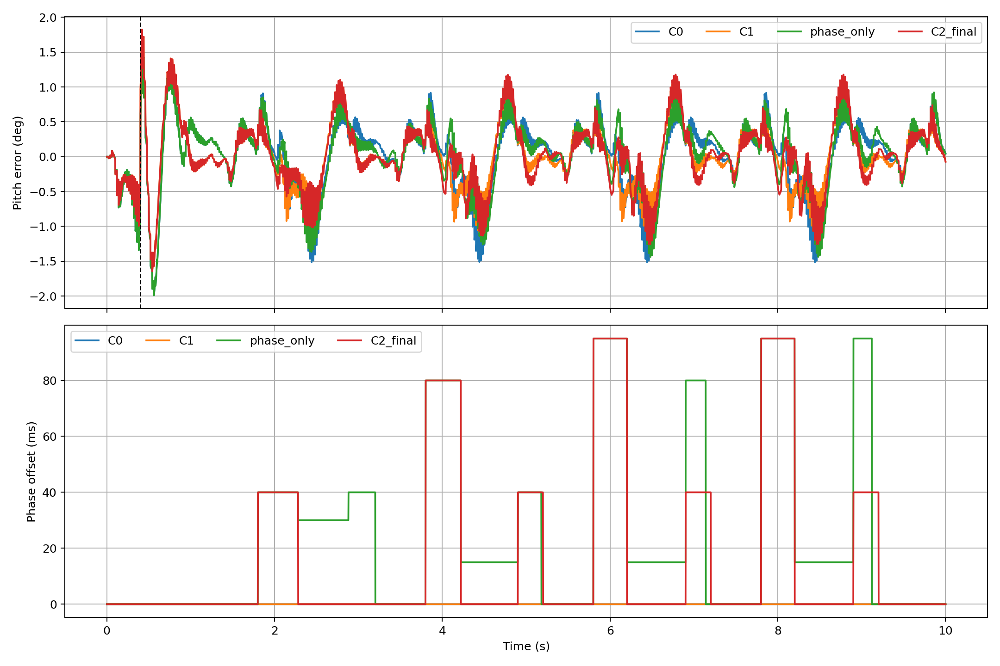

# Planar Biped: FDDP Planning and FIR-QP-MPC Control

这是一个面向低成本平面双足机器人（planar biped）的硕士研究项目。项目以离线 FDDP 轨迹优化为起点，在 MuJoCo 中完成名义轨迹回放，并逐级构建 C0、C1、C2 三种控制器，用于研究跟踪稳定性、扰动鲁棒性和接触相位同步。

项目已完成 MuJoCo 仿真、控制器对比和扰动测试，并实现硬件运行时的关节位置命令导出。真实机器人闭环行走仍在后续工作中。

## 项目目标

为使用位置控制舵机的平面双足机器人生成可跟踪的行走轨迹，并研究机器人受到扰动或触地时间变化时，如何修正关节命令、保持运动稳定。

## 系统主线

```text
机器人模型与任务定义
        ↓
离线 FDDP 多步轨迹优化
        ↓
10 s / 1000 节点名义参考轨迹
        ↓
MuJoCo 回放与可行性检查
        ↓
C0 名义跟踪
        ↓
C1 FIR-QP-MPC 姿态恢复
        ↓
C2 接触相位同步
        ↓
消融、扰动与时序证据
        ↓
硬件运行时导出（q_cmd）
```

离线规划输出包含关节状态参考和用于分析的 `tau_ref`。面向硬件的控制命令是位置形式：

```text
q_cmd = q_ref + delta_q
```

其中 `delta_q` 由在线控制器生成；`tau_ref` 在本项目中不是直接下发给舵机的力矩命令。

## 三层控制器

| 控制器 | 主要功能 | 工程含义 |
|---|---|---|
| C0 | 按时间回放名义参考 | 提供无在线修正的基线 |
| C1 | FIR 状态预测 + QP 约束修正 | 根据姿态误差生成受限的 `delta_q` |
| C2 | C1 + 接触观测与相位同步 | 当实际接触时刻偏离参考时调整参考相位 |

## 仿真结果

在相同仿真条件下，对 C0、C1 和 C2 进行了控制器对比：

- **轨迹规划**：生成 10 秒、1000 个节点的 10 步参考轨迹，并在 MuJoCo 中回放。
- **姿态恢复**：施加 2° 初始俯仰扰动后，C1 的俯仰误差积分从 C0 的 3.76 降至 3.35 °·s，峰值误差从 1.99° 降至 1.82°。
- **接触同步**：同一组对比中，C2 的平均触地时序误差为 34.3 ms，C0 为 56.7 ms。
- **扰动测试**：在 32 个预设仿真场景中，每个场景运行 30 个随机种子，共 960 次试验，均满足该批次设定的验收条件。



[查看对比结果数据](results/logs/fddp_multistep_controller_ablation.yaml) · [查看扰动测试说明](docs/2026-07-22_robustness_figures_speaker_notes_zh_en.md)

## 实验结论

仿真结果表明，离线轨迹能够在仿真模型中回放；在上述测试条件下，C1 降低了俯仰误差，C2 改善了触地时序。项目完成了从模型、规划到控制器对比的仿真验证，下一步是接入舵机和传感器，在实物上验证控制效果。

## 项目材料

- 已接受的 10 步、10 s、1000 节点 FDDP 名义轨迹。
- C0、C1、C2 的 MuJoCo 回放及逐层消融结果。
- 32 个扰动场景、每个场景 30 个随机种子的批量仿真记录，共 960 次采样试验。
- QP 控制更新的采样时序记录；该记录用于软件侧性能分析，不等同于硬实时认证。
- 不依赖 MuJoCo 的硬件运行时接口，可加载参考并输出关节位置命令。
- 论文、PPT、流程图和结果解释材料。

结果文件是当前项目快照中的归档证据。若重新运行实验，应同时记录环境、配置、随机种子和生成时间，避免将不同批次结果混用。

## 仓库结构

| 路径 | 内容 |
|---|---|
| `fddp/` | FDDP 规划、continuation 与轨迹导出 |
| `mpc/` | FIR-QP-MPC、接触相位同步与参数扫描 |
| `simulation/` | MuJoCo 回放、验证和实验入口 |
| `hardware/` | MuJoCo-free 控制器运行时与硬件交接接口 |
| `model/` | 机器人模型 |
| `config/` | 实验、控制器和证据配置 |
| `tests/` | 自动化测试 |
| `results/` | 日志、表格、图和归档结果 |
| `transfer/` | 轨迹和硬件交接数据 |
| `docs/` | 项目说明、论文材料和实验文档 |
| `deliverables/` | 汇报与阶段性交付物 |
| `tools/` | 报告、图表和文档生成工具 |

嵌套的 Overleaf 工作副本不纳入本仓库，它们继续由各自的 Git 历史独立管理。

## 环境

项目当前验证环境的核心版本为：

| 软件 | 版本 |
|---|---:|
| Python | 3.10.20 |
| NumPy | 2.2.6 |
| pandas | 2.3.3 |
| Matplotlib | 3.10.9 |
| SciPy | 1.15.2 |
| MuJoCo | 3.10.0 |
| Pinocchio | 4.0.0 |
| Crocoddyl | 3.2.1 |

推荐使用 Conda：

```bash
conda env create -f environment.yml
conda activate fddp_biped
```

不同平台上的 MuJoCo、Pinocchio 和 Crocoddyl 可用构建版本可能略有差异，因此 `environment.yml` 对核心库采用兼容版本范围，并在研究结果中保留上述实际验证版本。

## 快速验证

在仓库根目录运行：

```bash
python simulation/03_check_mujoco_model.py
python -m pytest -q -p no:cacheprovider tests
```

完整实验的入口、顺序和输出位置见 `docs/`、`config/fddp_multistep_experiment.yaml` 以及各阶段脚本中的命令行说明。批量仿真会消耗较多时间，建议先使用已有归档结果检查流程，再按需要重新生成。

## 硬件阶段仍需完成

当前运行时不会直接驱动舵机。真实机器人闭环验证仍需要：

1. 舵机通信桥接、关节方向与零位标定；
2. 传感器采集和状态估计；
3. 看门狗、超时、急停和故障处理；
4. 控制周期与通信延迟实测；
5. 从支撑装置上的低风险单步测试逐步过渡到连续行走。

本仓库展示该学术项目的代码与实验资料。
